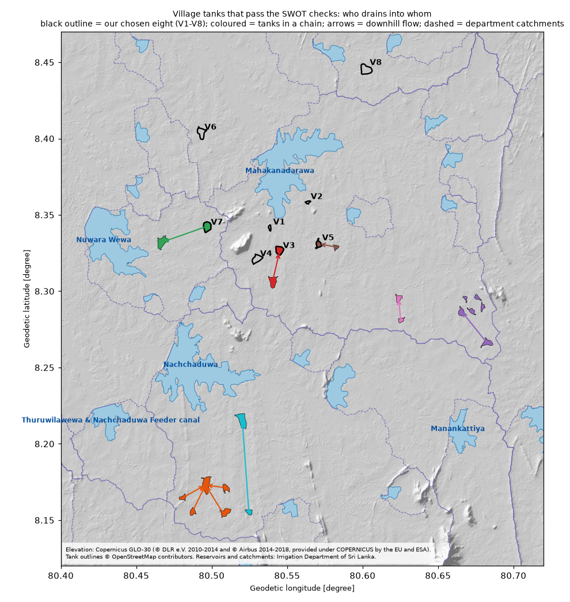

# Do the eight village tanks share one cascade? (29 Oct 2026)

**Answer: no.** Two separate sources agree on where each tank's water goes:
- the Irrigation Department's own reservoir catchment map (fetched 25 Oct 2026);
- a downhill flow trace on the Copernicus GLO-30 elevation map (`scripts/c1_flow_trace.py`).

| Tank | Outline | Inside the department catchment of | Where its water goes (flow trace) |
|---|---|---|---|
| V1 | 5 ha | Mahakanadarawa | straight into Mahakanadarawa |
| V2 | 5 ha | Mahakanadarawa | straight into Mahakanadarawa |
| V3 | 27 ha | Mahakanadarawa | straight into Mahakanadarawa (one SWOT-ready tank drains into V3) |
| V4 | 29 ha | Mahakanadarawa | straight into Mahakanadarawa |
| V5 | 15 ha | Mahakanadarawa | straight into Mahakanadarawa (one SWOT-ready tank drains into V5) |
| V6 | 31 ha | none | north through three other tanks (25, 59 and 39 ha), then on to the north-west, away from Mahakanadarawa |
| V7 (Bulankulama) | 32 ha | Nuwara Wewa | through two other tanks into Nuwara Wewa |
| V8 | 43 ha | Kallanchiya (inside Kadahatha Wewa's) | into Kallanchiya, a medium reservoir |

- None of the eight drains into another of the eight. Tanks 1–5 sit in separate small valleys that each feed Mahakanadarawa, so even they are not one chain.
- The study still works, because RQ1–RQ4 are answered tank by tank. Only the "every tank in a cascade" picture is affected.

## A real cascade we could use

I searched all the SWOT-ready village tanks for chains (`scripts/c2_cascade_search.py`). It used the same filters as the feasibility check: 6.25–25 ha by SWOT reference area, 40+ usable readings, a rise and fall of 1 m or more, small jumps, 5% or fewer outliers, an outline under 60 ha, and within 12 km of the big five. That gives the same 49 tanks as the feasibility check; 17 of them are in a chain.

The search found 7 chains. The biggest is south of Nachchaduwa:

| SWOT lake ID | Outline | Usable readings | Drains into |
|---|---|---|---|
| 4580025632 | 15 ha | 80 | 4580008112 |
| 4580012322 | 13 ha | 76 | 4580008112 |
| 4580010392 | 28 ha | 81 | 4580008112 |
| 4580012282 | 19 ha | 80 | 4580008112 |
| 4580008112 | 49 ha | 49 | Nachchaduwa (daily gauge) |

- All five lie inside Nachchaduwa's department catchment, and both SWOT passes (092 and 273) see them.
- None has a name in OpenStreetMap or in SWOT's lake list.
- Their plant cover has not been checked yet; that is the same Sentinel-2 check as `../feasibility-check/work/a6_shortlist.py`.

The other chains each have two tanks:
- V7 → 4580005192 → Nuwara Wewa;
- 4580007532 → V3 → Mahakanadarawa;
- 4580007452 → V5 → Mahakanadarawa;
- 4580012052 → 4580005302 → Mahakanadarawa;
- 4580010692 → 4580009592 → Mahakanadarawa;
- 4580010862 → 4580009722 → Nachchaduwa.

## Limits
- The links between village tanks come from the elevation map only. It is a surface model (trees and buildings included) at 30 m, so a small canal or a cut bund can change a link. The department catchments confirm only where each chain ends.
- The Agrarian Development Department's cascade map is the authority. We have not seen it: it isn't online.
- **Local names can't be checked from open data.** OpenStreetMap and SWOT's lake list have none for these tanks. GeoNames lists nearby villages, but a tank's name often differs from the village's. Someone has to ask the Agrarian Services Centre or the Grama Niladhari.

## Run it again

Run everything from this folder (`cascade-check/`). Python packages: geopandas, rasterio, numpy, pandas, matplotlib.

| Step | Command | Writes |
|---|---|---|
| 1 | `python -I web-scripts/fetch_irrigation_layers.py` (the Irrigation Department's open ArcGIS layers, no login) | `web-sources/irrigation_layers/*.geojson` (about 26 MB, not included) |
| 2 | `python -I osm/scripts/01_fetch_overpass.py water_areas` (OpenStreetMap, through the Overpass API) | `osm/download/overpass_water_areas.json` (3 MB, not included) |
| 3 | Download the elevation tile [Copernicus_DSM_COG_10_N08_00_E080_00_DEM.tif](https://copernicus-dem-30m.s3.amazonaws.com/Copernicus_DSM_COG_10_N08_00_E080_00_DEM/Copernicus_DSM_COG_10_N08_00_E080_00_DEM.tif) (47 MB) into `terrain/dem_download/` | |
| 4 | `python -I scripts/c1_flow_trace.py . study_tanks.geojson out` | `out/flow_trace.json` (and a 12 MB flow grid, not included) |
| 5 | `python -I scripts/c2_cascade_search.py .. out` | `out/chains.json`, `out/candidates_flow.csv`, `out/candidates.geojson` |
| 6 | `python -I scripts/c3_check_and_map.py .. out` | `out/chains_checked.csv`, `out/cascade_map.png` |

- `study_tanks.geojson`: the 13 study tanks' outlines from OpenStreetMap, made in the feasibility check.
- `web-sources/analysis/points_used.csv`: the eight village tanks' SWOT lake IDs and their names V1–V8.
- Step 5 also needs the feasibility check's cached SWOT series, `../feasibility-check/work/hydrocron/` (not included): run `../feasibility-check/work/a2_fetch.py` first.

**Credits:**
- Elevation: Copernicus GLO-30 (© DLR e.V. 2010–2014 and © Airbus 2014–2018, provided under COPERNICUS by the European Union and ESA).
- Tank outlines: © OpenStreetMap contributors.
- Reservoirs, catchments and streams: Irrigation Department of Sri Lanka.
- SWOT lake IDs: NASA/JPL and CNES.
