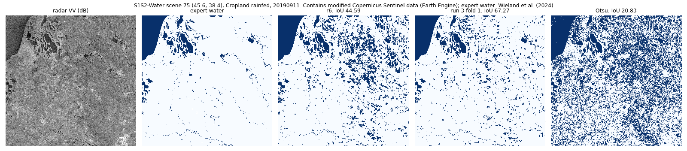
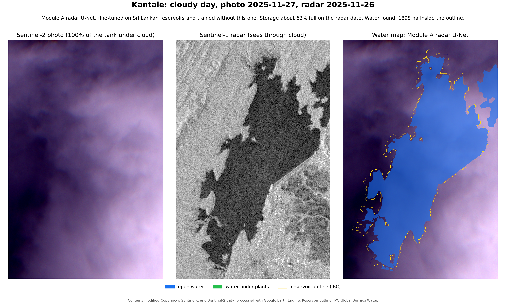

# Module A: water maps under cloud (RQ1)

Results from 1 to 10 November 2026: runs 1 to 5 of the retraining, the final model, a check against expert water maps, and the second series' development work. Module A maps the water in Sri Lanka's reservoirs from satellite images, under cloud too, and turns the water area into storage. Every check compares the result with the Irrigation Department's daily storage.

This page gives the method, the numbers and the pictures. The code, the protocols and the full results are in `code/` and `docs/` (published 6 Nov, updated 10 Nov 2026). A plain-English overview of the whole module is in `docs/MODULE-A-SUMMARY.md`. The department's tables and the trained models stay private.

## Data

- **Our two public datasets on Kaggle** (CC BY 4.0), made with Google Earth Engine:
  - [Sri Lankan Reservoirs: Sentinel-1 and 2 Chips](https://www.kaggle.com/datasets/mehararothila/is4990-module-a-first-check-chips): 3,843 chips of 117 reservoirs, on clear and cloudy days from July 2023 to December 2025.
  - [Sri Lankan Reservoirs: Every Sentinel-1 Pass](https://www.kaggle.com/datasets/mehararothila/is4990-module-a-pass-chips): 16,552 radar chips of the same 117 reservoirs, from October 2020 to October 2026.
- **Sen1Floods11:** flood chips with expert labels, for training and for an outside check on Bolivia, a country kept out of training.
- **Storage:** the Irrigation Department's daily reservoir status (not shared here).

## 1. The first models (1 Nov)

U-Nets trained on Sen1Floods11, using radar only, the photo only, or both. Water IoU on the test chips (mean of 3 seeds):
- radar and photo together: 83%. Under simulated full cloud it falls to 57%.
- radar only: 65%, with or without cloud.

## 2. Seven tanks, clear and cloudy days (1 Nov)

At 7 tanks with daily storage (103 cloudy days), the radar-only U-Net followed storage best:
- Spearman 0.95 on clear days and 0.91 on cloudy days;
- under cloud, storage read within 9% of capacity (median over the 7 tanks). By tank it ranged from 4 to 26%, and the two smallest tanks were the worst.

The models that use the photo failed under thick cloud.

## 3. 100 reservoirs (2 Nov)

*r2 and r6 are radar-only U-Nets; r3 ("fusion") uses radar and the photo.*

- **Coverage:** 117 reservoirs from the department's sheet. 100 passed quality rules that were set before the results were seen; the other 17 were left out, each for a stated reason.
- **Chips:** 2,976, of which 1,429 are on clear days and 1,547 on cloudy days.
- **Under cloud, only radar works.** The radar-only U-Net follows storage at a median Spearman of 0.79 and reads storage within 11% of capacity, against 20% with no model. Under cloud, the methods that use the photo do worse than no model (27 to 32%). A radar threshold tuned for each reservoir reads storage about as well (11.0%), but the U-Net follows storage more closely (better Spearman at 72% of reservoirs).
- **Bigger reservoirs are read better:** 7% error at 30 million m³ and more, against 13.5% under 5 million m³.

## 4. Every radar pass since 2020 (2 Nov)

- **Coverage:** 107 reservoirs and 15,430 radar passes.
- **Test:** a curve fitted on the first half of each reservoir's passes reads storage on the second half, as the system would run.
- **Result:** the radar U-Net reads later storage within 12% of capacity, against 14% for the seasonal average and 22% with no model. It beats no model at 87% of reservoirs and the seasonal average at 65%. Clouds make no difference to it.
- **Two limits:**
  - near full, the reading flattens: at 44 of 104 reservoirs it is 15 points of capacity or more too low;
  - at low storage, the radar calls much of the exposed lake bed water.

## 5. Retraining for tank beds (2 and 3 Nov)

**Labels without hand labelling.** A reservoir fills like a bowl. When storage rises past a certain level, a spot on its bed goes under water, and it stays under water at any higher storage. Each spot's level is learnt from the reservoir's clear photos and the storage on their dates. On any radar pass, the storage then says which spots are water and which are dry, and spots close to their level are left unsure. The labels have three classes: land, open water and water under plants.

**Fair testing.** The reservoirs are split into five folds. Each reservoir is tested by a model trained without it and without its storage. The rules for a win were fixed before each run.

**Run 1 (a trial):**

| Storage error on the later half (median, % of capacity) | Reservoirs | Retrained | Radar U-Net before | VV threshold tuned to the photo | Seasonal average | No model |
|---|---|---|---|---|---|---|
| All | 107 | **8.9** | 12.1 | 12.6 | 14.2 | 21.9 |
| Under 5 million m³ | 41 | 12.1 | 13.7 | 13.2 | 16.2 | 25.7 |
| 5 to 30 million m³ | 35 | 7.5 | 11.6 | 12.1 | 14.4 | 17.2 |
| 30 million m³ and more | 31 | 5.2 | 8.9 | 10.5 | 13.6 | 22.9 |

- It is better than the radar U-Net before at 68% of reservoirs (Wilcoxon p = 1e-5).
- At low storage, it calls 74% fewer known-dry spots water.
- **It is not a win by its own rules.** On Sen1Floods11's Bolivia chips it lost 2.5 points of water IoU (56.1 against 58.6), and the limit was 2.

*Akathimuruppu, held out of training ("run 2" in the picture is the radar U-Net before retraining). In the middle row, at 10% storage, the model before marks most of the dry bed as water, while the retrained model keeps to the pool in the south.*

**Run 2 (the main test, 103 reservoirs).** Compared with run 1, it has:
- better labels (more land, and a guard against cloud shadows);
- folds that keep neighbouring reservoirs together;
- a cleaned storage sheet;
- three seeds per fold;
- a control model trained on photo labels alone.

| Storage error on the later half (median, % of capacity) | Reservoirs | Retrained | Photo-label control | Radar U-Net before | Seasonal average | No model |
|---|---|---|---|---|---|---|
| All | 103 | **7.9** | 8.5 | 12.5 | 14.4 | 22.5 |
| Under 5 million m³ | 39 | 11.0 | 11.5 | 13.7 | 15.2 | 26.1 |
| 5 to 30 million m³ | 34 | 7.9 | 7.5 | 10.5 | 14.4 | 17.3 |
| 30 million m³ and more | 30 | 5.4 | 5.2 | 8.8 | 13.3 | 22.7 |

- **Four of its five rules hold.** It is better than the radar U-Net before at 79% of reservoirs (Wilcoxon p = 2e-10), better than every threshold method and the seasonal average, and closer to the photo on the dry lake bed.
- **The fifth fails, so run 2 is not a win by its own rules.** On Sen1Floods11's Bolivia chips its water IoU fell to 44.8, against 58.6 for the model it started from, and the limit was 2 points. Training on tank labels made the model better at reading tank storage, but worse at mapping flood water.
- **The labelling rule is not what helps.** A control trained only on clear-day photo labels, with no storage and no radar passes, does as well (8.5%, p = 0.31). So the gain comes from training on our own reservoirs, and neither the rule nor the extra radar passes added to it.

**Run 3 (3 Nov, rules fixed first).** To keep flood-mapping skill:
- it starts from run 6;
- a quarter of every batch is Sen1Floods11's expert-labelled flood chips;
- the photo-label control now sees the same photo-labelled radar passes, so the comparison is fair.

| Storage error, later half (median, % of capacity, 103 reservoirs) | |
|---|---|
| Run 3 | **7.8** |
| Run 2's retrained model | 7.9 |
| Photo-label control (fair) | 8.3 |
| Run 6, the starting model | 10.8 |
| Seasonal average | 14.4 |

- **Rules 1 to 4 hold again.** For example, run 3 is better than run 6 at 80% of reservoirs (p = 4e-9).
- **Rule 5 fails, so run 3 is not a win by its own rules either.** Bolivia rose from 44.8 to 54.4 at no cost to storage, but the rule asked for at least 64. On Sen1Floods11's own test floods the model keeps about 67; what drops is the unseen Bolivia flood.
- **Photo labels are enough.** Even against a fair control, the labelling rule adds nothing (p = 0.96), and photo labels need no storage records.
- **The result does not depend on the computer.** Fold 4 ran on Kaggle and on Colab with identical results.

## 6. Against the last clear photo (3 Nov)

Without radar, a user would read storage from the most recent clear photo. To test this baseline:
- we measured the photo's water area inside each reservoir's outline on every Sentinel-2 date from August 2020 to October 2026;
- on each radar pass, we took the last photo with at least 98% of the outline clear.

**How often there is a clear photo:**
- a median of 20 a year per reservoir;
- the longest gap between them is a median of 138 days, and November and December have the fewest;
- on the later half, the last clear photo is a median of 13 days old, and over 30 days old on 29% of passes.

With run 2 (103 reservoirs):

| Storage error, later half (median, % of capacity) | All passes | Photo 10 days old or less | Photo over 30 days old |
|---|---|---|---|
| Retrained radar U-Net (run 2) | **7.9** | 7.9 | 8.4 |
| Photo-label control | 8.1 | **7.4** | **7.7** |
| Radar U-Net before | 12.3 | 11.2 | 10.9 |
| Last clear photo | 12.9 | 9.5 | 19.5 |
| Seasonal average | 14.2 | 13.7 | 13.6 |
| No model | 22.5 | 23.0 | 21.2 |

- The retrained model beats the last clear photo at 81% of reservoirs (p = 2e-10), and at 86% when the photo is over 30 days old (p = 9e-12). Run 1 showed the same picture (8.8 against 12.9).
- **A limit:** at small reservoirs (under 5 million m³) with an old photo, the seasonal average (9.6) is still the best.

*The two reservoirs were picked by rank, among those with 10 or more old-photo passes. At Kantale (the middle by the radar's gain), the radar is off by 2% of capacity against 7% for the photo. At Parakrama Samudraya (the lower quarter), it is 4% against 6%.*

## 7. Against expert water maps (S1S2-Water, 4 Nov)

S1S2-Water is a public dataset of lakes, rivers and reservoirs around the world, with the water mapped by experts (Wieland et al., 2024). We scored the models on its 15 test scenes, which they had never seen, and trained nothing on them. The rules were fixed before the scoring.

- **The radar** is Earth Engine's, for each scene's own Sentinel-1 images, made the same way as our training radar. The experts' masks were moved to its 10 m grid.
- **Why not S1S2-Water's own radar:** it was smoothed with a median speckle filter, and our models fail on smoothed radar. On Sen1Floods11's Bolivia chips, r6 falls from 66 to 7 after the same smoothing.

| 15 test scenes, pooled | Water IoU | F1 |
|---|---|---|
| Otsu radar threshold | 34 | 50 |
| Radar U-Net before (r6) | 53 | 69 |
| Retrained (run 3) | **60** | **75** |
| Photo-label control | **65** | **79** |

- **Retraining on our tanks did not cost water-mapping skill; it added some.** Run 3 beats r6 at 11 of 15 scenes (p = 0.02), so its loss on Bolivia is specific to floods.
- **All the U-Nets beat a simple radar threshold.**
- **Photo labels beat the storage rule here too:** 65 against 60, and better at 11 of 15 scenes.
- **On 5 South and Southeast Asian scenes** (India, Bangladesh, Thailand and Vietnam), run 3 scores 92 and the control 93. These come from S1S2-Water's other splits, and they are new to our models too.
- **The weak spot is false water on dark, dry land.** The models find 98% of the experts' water, but a third or more of what they call water is dry ground: desert, dry grassland or terrain shadow.

*S1S2-Water scene 75, cropland near the Sea of Azov: the radar, the experts' water, r6, run 3 (fold 1) and Otsu. Run 3 drops most of r6's false water in the fields.*

*Kantale on 27 November 2025, with the whole tank under cloud. The water map comes from the radar alone, made by a fine-tuned model that never saw Kantale in training, and is drawn on the photo.*

## 8. Run 4: cutting the false water on dry land (4 and 5 Nov)

Run 4 went after the weak spot in section 7. The rules were fixed before any training data was prepared. It starts from the photo-label control and changes these things together:
- 29 of S1S2-Water's training scenes join the training (expert labels; the test scenes and the 5 Asian scenes stay unseen);
- ground that has never been water in 38 years of Landsat history is labelled land;
- dry lake beds count twice;
- every batch mixes our reservoirs, Sen1Floods11 floods and S1S2-Water scenes.

To win, run 4 had to clear four rules: much less false water abroad, and no loss on our reservoirs' water maps, on storage or on floods.

| Rule | Run 4 | Control | Needed | Holds? |
|---|---|---|---|---|
| 1. S1S2-Water, 15 test scenes, water IoU | **86** | 65 | 68 or more | yes |
| 2. Our reservoirs against Google's Dynamic World, median reservoir IoU | 89.1 | 90.4 | 89.4 or more | no |
| 3. Storage error, % of capacity (103 reservoirs) | 8.7 | 8.3 | within 0.5 (shown by test) | no (p = 0.09) |
| 4. Sen1Floods11 test floods, water IoU | 65.5 | 67.6 | 65.6 or more | no |

- **The false water is mostly gone.** On S1S2-Water, run 4 is better than the control at 13 of 15 scenes. Of what it calls water, 89% is water, against 66% before, and it still finds 95% of the experts' water. On the 5 Asian scenes it scores 95, against 93.
- **At home it costs a little.** Our reservoirs had almost no false water to remove (99% of what the models call water is water there), so the change only takes away a little real water: the pooled IoU against Dynamic World is 91.3 against 91.8, and the storage error 8.7% against 8.3%.
- **So run 4 is not a win by its own rules.** It misses three of them by small margins, and run 3 stays our model for storage.
- **One caution:** run 4 learned from other S1S2-Water scenes (at least 223 km from any test scene), so part of its gain may be that it knows that dataset's style of labelling.

## 9. Run 5: the same fix, with more of our own reservoirs (5 Nov)

Run 4 cut the false water abroad but lost a little at home. Run 5 changes one thing: every batch of 16 crops now holds 10 from our reservoirs, 4 Sen1Floods11 floods and 2 S1S2-Water scenes (run 4: 8, 4 and 4). Everything else is run 4's. Its rules, run 4's four rules with the same bars, were fixed before it was trained, and it is the last run in this series.

| Rule | Run 5 | Run 4 | Control | Needed | Holds? |
|---|---|---|---|---|---|
| 1. S1S2-Water, 15 test scenes, water IoU | **84.6** | 85.6 | 65.3 | 68.3 or more | yes |
| 2. Our reservoirs against Google's Dynamic World, median reservoir IoU | 89.48 | 89.12 | 90.35 | 89.35 or more | yes |
| 3. Storage error, % of capacity (103 reservoirs) | 8.65 | 8.69 | 8.28 | within 0.5 (shown by test) | yes (p = 0.004) |
| 4. Sen1Floods11 test floods, water IoU | 65.67 | 65.55 | 67.6 | 65.6 or more | yes |

- **It keeps the gain abroad.** On S1S2-Water, run 5 is better than the control at 13 of 15 scenes. Of what it calls water, 88% is water (66% for the control), and it finds 95% of the experts' water. On the 5 Asian scenes it scores 94, against 93.
- **At home it now passes, by small margins.** The median reservoir IoU passes by 0.13 and the flood test by 0.07. A test now shows the storage error within the 0.5 allowed: the difference from the control is +0.16 points of capacity (95% interval -0.05 to +0.40). Run 5 is still a little below the control at home, within the limits rather than better.
- **So run 5 is now Module A's model.** One caution: its change was chosen after seeing run 4's scores on the same test data, so it is weaker evidence than a fresh test would be. Run 4 stays the main test of the fix.
- **It is weaker on the Bolivia flood test** (a country kept out of training): 42, against 48.5 for the control. This is not one of the rules, but we report it.
- **A final model for use.** Each of the five models above trained on four fifths of the reservoirs and was tested on the rest. A final model trained the same way on all 103 reservoirs is the one for new radar passes and new tanks. Before it ran, we set the ranges it had to land in on the outside tests, as a check for errors. It scores 87 on S1S2-Water and 65 on Sen1Floods11, both inside them. The five-fold results stay the evidence.

## 10. The second series so far (5 to 10 Nov)

Run 5's tests had been used several times, so the second series is judged only on fresh tests fixed in advance (`docs/PROTOCOL-6.md`):
- radar passes from 1 Nov 2026 to 31 Jan 2027 against the department's daily storage, scored in February 2027;
- 14 S1S2-Water scenes that no model has seen;
- an outside flood dataset.

Until then, everything is chosen on development data only: the first half of each reservoir's history, with each curve fitted on the first quarter and scored on the second. **The numbers below are development numbers, not claims.**

- **Longer training does not help at home.** Two variants of run 5's recipe were tried: three times the training steps, and the same with an extra loss that rewards overlap (Lovász). Both gained on floods but lost on our reservoirs' maps, and neither improved storage. Run 5's recipe stays.
- **The map is no longer the main limit.**
  - With water areas from clear photos instead of the radar, the storage error is worse (8.4% against 6.7% of capacity).
  - Near full, both the photo's and the radar's water area stop growing (97% of their top size at 85 to 95% full) while storage still changes.
  - So the reading scatters there: when it says 75 to 85% full, it is off by about 9 points either way.
- **A curve that bends near full helps.** Six curve forms were fixed in advance (`docs/PROTOCOL-CURVE.md`). A hinged log-log line that may only bend upward reads storage within 5.6% of capacity, against 6.7% for today's straight line. Reservoir by reservoir, the gain is 0.32 points (95% interval 0.19 to 0.74). Neither smoothing over time nor the morning passes improved it (13,808 passes of the second orbit were measured to test the morning passes).
- **All five fold models in one map, and turns and flips at inference, are not kept (10 Nov).** By rules fixed before the run (`docs/DEV-6.md`), one map from all five fold models raised the water IoU at all 10 development scenes of S1S2-Water, but only by 0.18 on average (0.3 was needed). Adding the eight turns and flips at inference lost 1.41 on one scene. So run 5's maps stay.
- **The February test.**
  - A dry run of its scorer on development data gives today's method 6.7%, the new curve 5.8%, the seasonal average 15% and no model 21%.
  - The new curve passes the no-loss rule, but its gain is under the 0.5 points needed to claim an improvement.
  - The test window is the season when reservoirs are most often full.

## Code and documents

| Folder | What it holds |
|---|---|
| `docs/` | A plain-English overview (`MODULE-A-SUMMARY.md`); every protocol, fixed before its run (`PROTOCOL.md` to `PROTOCOL-6.md`, `PROTOCOL-CURVE.md`, `PROTOCOL-S1S2.md`, `PROTOCOL-PHOTO.md`); the results of each run (`RESULTS-run1.md` to `RESULTS-run5.md`, `RESULTS-s1s2water.md`, `RESULTS-photo.md`); the final model (`FINAL-MODEL-5.md`); and the second series' development plan and results (`DEV-6.md`) |
| `code/module-a-retrain/` | Training and scoring: `kernel5/` is run 5's recipe (the current model), `kernel3/retrain.py` holds the storage scoring, `kernel6-dev/` the second series' development runs, `kernel6-morning/` the measuring of the morning passes, `scripts/` the labels, scorers (including the error budget, the curve study and the February test's scorer) and Kaggle builders |
| `code/module-a-reservoirs/scripts/` | Earth Engine exports of the reservoir chips and every radar pass |
| `code/s1s2water-check/` | The scoring against S1S2-Water's expert water maps |
| `code/module-a-photo-check/`, `code/module-a-kaggle/kernel/` | The Dynamic World check, and the first training series on Sen1Floods11 (which made r6) |

The code reads its data from our Kaggle datasets and from the department's daily storage, which is not published.

## Next

- **Module A's model is run 5,** in its final version trained on all 103 reservoirs.
- **The second series' fresh tests** (`docs/PROTOCOL-6.md`): the storage test is scored in February 2027, after its window closes; the two map tests are prepared by 15 January 2027.
- **Water under plants.** The model has a class for it, but the photo labels used from run 4 on contain no examples of it, so it is not trained or tested yet. Finding trustworthy examples without hand labelling is the next step for Module A.
- **Water areas for Module B:** every radar pass at the 103 reservoirs, each from a model that never trained on that reservoir. Near full, where the radar's reading flattens, SWOT's water height has to carry the storage (Module B).
- **Pixel agreement on our own tanks,** against the clear photo (agreement, not ground truth).

## Credits

- Contains modified Copernicus Sentinel data (2020 to 2026), processed with Google Earth Engine.
- Sen1Floods11: Bonafilia et al. (2020), CVPR Workshops.
- S1S2-Water: Wieland et al. (2024), IEEE JSTARS; CC BY 4.0.
- Reservoir outlines: JRC Global Surface Water (Pekel et al., 2016).
- Storage: Irrigation Department of Sri Lanka, daily reservoir status.
