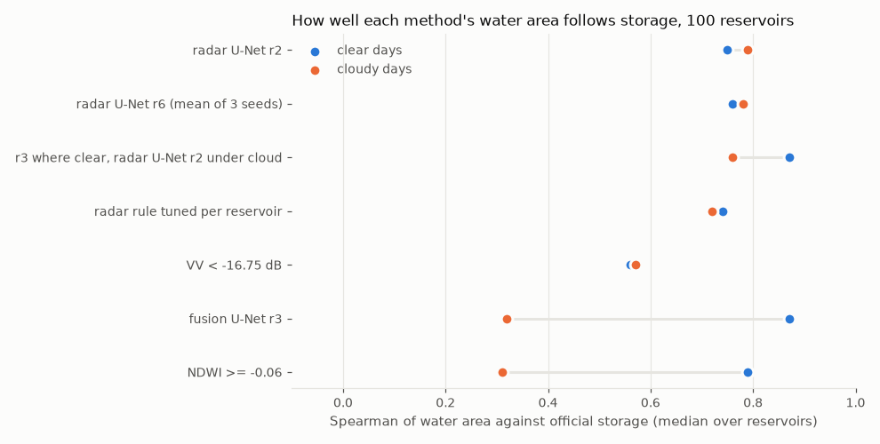
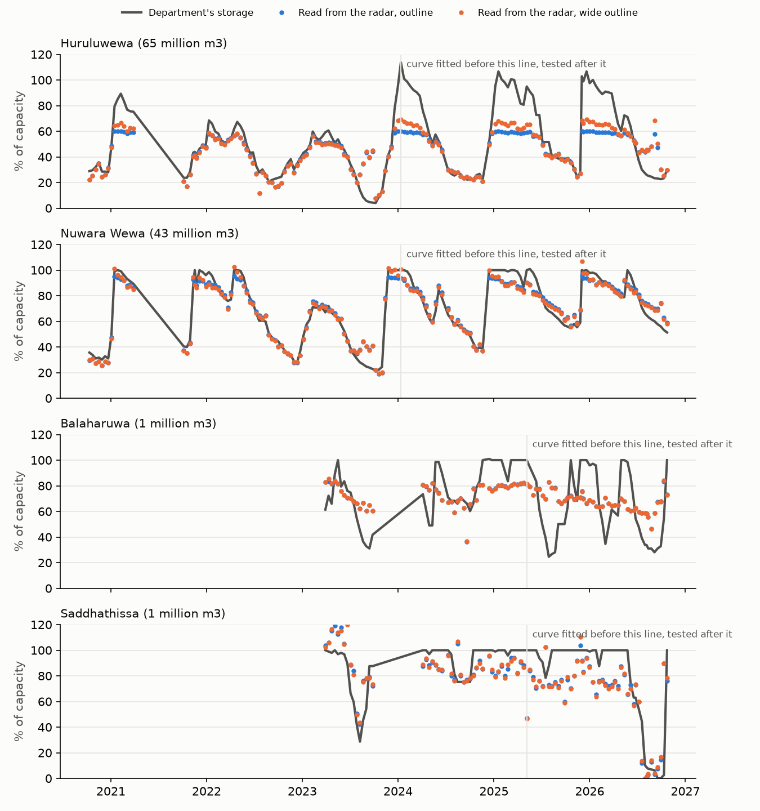
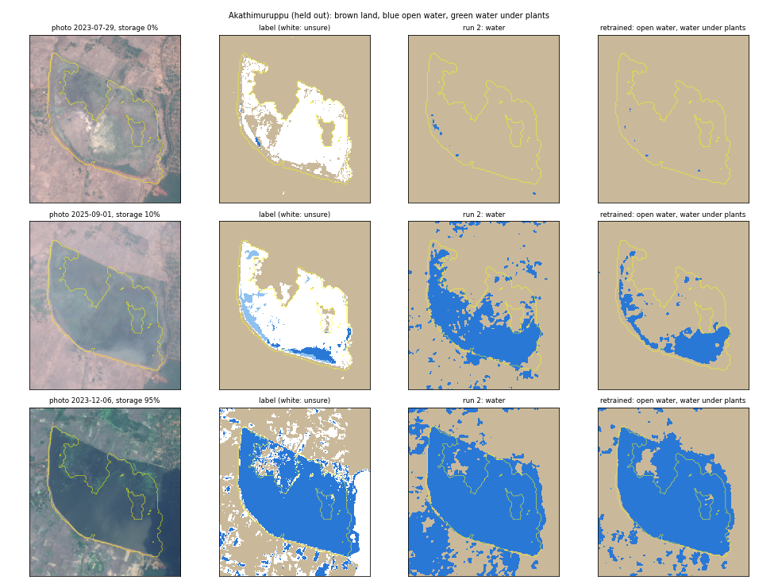
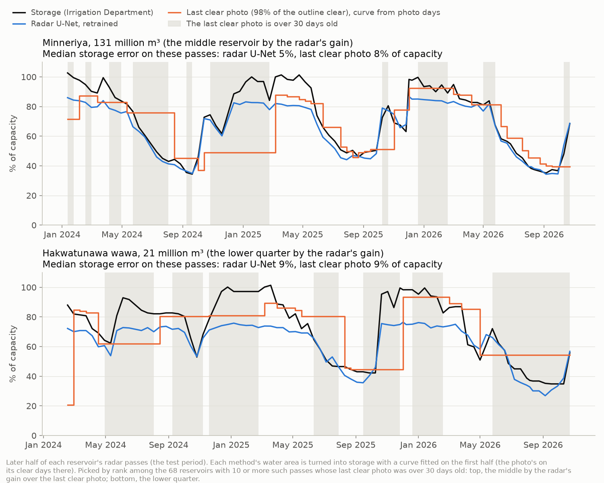

# Module A: water maps under cloud (RQ1)

Results from 1 to 3 November 2026. Module A maps the water in Sri Lanka's reservoirs from satellite images, under cloud too, and turns the water area into storage. Every check compares the result with the Irrigation Department's daily storage.

The code, the department's tables and the trained models are kept private. This page gives the method, the numbers and the pictures.

## Data

- **Our two public datasets on Kaggle** (CC BY 4.0), made with Google Earth Engine:
  - [Sri Lankan Reservoirs: Sentinel-1 and 2 Chips](https://www.kaggle.com/datasets/mehararothila/is4990-module-a-first-check-chips): 3,843 chips of 117 reservoirs, on clear and cloudy days from July 2023 to December 2025.
  - [Sri Lankan Reservoirs: Every Sentinel-1 Pass](https://www.kaggle.com/datasets/mehararothila/is4990-module-a-pass-chips): 16,552 radar chips of the same 117 reservoirs, from October 2020 to October 2026.
- **Sen1Floods11:** flood chips with expert labels, for training and for an outside check on Bolivia, a country kept out of training.
- **Storage:** the Irrigation Department's daily reservoir status (not shared here).

## 1. The first models (1 Nov)

U-Nets trained on Sen1Floods11, using radar only, the photo only, or both. Water IoU on the test chips (mean of 3 seeds):
- radar and photo together: 83%. Under full cloud it falls to 57%.
- radar only: 65%, with or without cloud.

## 2. Seven tanks, clear and cloudy days (1 Nov)

At 7 tanks with daily storage (103 cloudy days), the radar-only U-Net followed storage best:
- Spearman 0.95 on clear days and 0.91 on cloudy days;
- under cloud, storage read within 9% of capacity (median over the 7 tanks).

The models that use the photo failed under thick cloud.

## 3. 100 reservoirs (2 Nov)

*r2 and r6 are radar-only U-Nets; r3 ("fusion") uses radar and the photo.*

- **Coverage:** 117 reservoirs from the department's sheet. 100 passed quality rules that were set before the results were seen; the other 17 were left out, each for a stated reason.
- **Chips:** 2,976, of which 1,429 are on clear days and 1,547 on cloudy days.
- **Under cloud, only radar works.** The radar-only U-Net follows storage at a median Spearman of 0.79 and reads storage within 11% of capacity, against 20% with no model. Under cloud, the methods that use the photo do worse than no model (27 to 32%).
- **Bigger reservoirs are read better:** 7% error at 30 million m³ and more, against 13.5% under 5 million m³.

## 4. Every radar pass since 2020 (2 Nov)

- **Coverage:** 107 reservoirs and 15,430 radar passes.
- **Test:** a curve fitted on the first half of each reservoir's passes reads storage on the second half, as the system would run.
- **Result:** the radar U-Net reads later storage within 12% of capacity, against 22% with no model, and beats no model at 87% of reservoirs. Clouds make no difference to it.
- **Two limits:**
  - near full, the reading flattens: at 44 of 104 reservoirs it is 15 points of capacity or more too low;
  - at low storage, the radar calls much of the exposed lake bed water.

## 5. Retraining for tank beds (2 and 3 Nov)

**Labels without hand labelling.** A reservoir fills like a bowl. When storage rises past a certain level, a spot on its bed goes under water, and it stays under water at any higher storage. Each spot's level is learnt from the reservoir's clear photos and the storage on their dates. On any radar pass, the storage then says which spots are water and which are dry, and spots close to their level are left unsure. The labels have three classes: land, open water and water under plants.

**Fair testing.** The reservoirs are split into five folds. Each reservoir is tested by a model trained without it and without its storage. The rules for a win were fixed before each run.

**Run 1 (a trial):**

| Storage error on the later half (median, % of capacity) | Reservoirs | Retrained | Radar U-Net before | VV threshold tuned to the photo | Seasonal average | No model |
|---|---|---|---|---|---|---|
| All | 107 | **8.9** | 12.1 | 12.6 | 14.2 | 21.9 |
| Under 5 million m³ | 41 | 12.1 | 13.7 | 13.2 | 16.2 | 25.7 |
| 5 to 30 million m³ | 35 | 7.5 | 11.6 | 12.1 | 14.4 | 17.2 |
| 30 million m³ and more | 31 | 5.2 | 8.9 | 10.5 | 13.6 | 22.9 |

- It is better than the radar U-Net before at 68% of reservoirs (Wilcoxon p = 1e-5).
- At low storage, it calls 74% fewer known-dry spots water.
- **It is not a win by its own rules.** On Sen1Floods11's Bolivia chips it lost 2.5 points of water IoU (56.1 against 58.6), and the limit was 2.

*Akathimuruppu, held out of training ("run 2" in the picture is the radar U-Net before retraining). In the middle row, at 10% storage, the model before marks most of the dry bed as water, while the retrained model keeps to the pool in the south.*

**Run 2** is the main test, with better labels, three seeds and stricter rules. It is running on Kaggle, and its results will follow.

## 6. Against the last clear photo (3 Nov)

Without radar, a user would read storage from the most recent clear photo. To test this baseline:
- we measured the photo's water area inside each reservoir's outline on every Sentinel-2 date from August 2020 to October 2026;
- on each radar pass, we took the last photo with at least 98% of the outline clear.

**How often there is a clear photo:**
- a median of 20 a year per reservoir;
- the longest gap between them is a median of 138 days, and November and December have the fewest;
- on the later half, the last clear photo is a median of 12 days old, and over 30 days old on 29% of passes.

| Storage error, later half (median, % of capacity) | All passes | Photo 10 days old or less | Photo over 30 days old |
|---|---|---|---|
| Retrained radar U-Net (run 1) | **8.8** | **8.0** | **10.4** |
| Radar U-Net before | 12.1 | 11.2 | 11.2 |
| Last clear photo | 12.9 | 9.5 | 19.9 |
| Seasonal average | 14.2 | 14.2 | 13.6 |
| No model | 21.9 | 22.3 | 21.2 |

- The retrained model beats the last clear photo at 76% of reservoirs (p = 2e-8), and at 79% when the photo is over 30 days old (p = 9e-10).
- **A limit:** at small reservoirs (under 5 million m³) with an old photo, the seasonal average (9.6) beats every map.

## Next

- Check run 2's results against its rules ([issue #9](https://github.com/jarvis-uom/IS4990-project/issues/9) in the main repo).
- Storage near full, where the radar's reading flattens: add SWOT's water height (Module B).
- Pixel accuracy on expert-labelled benchmarks (Sen1Floods11, S1S2-Water).

## Credits

- Contains modified Copernicus Sentinel data (2020 to 2026), processed with Google Earth Engine.
- Sen1Floods11: Bonafilia et al. (2020), CVPR Workshops.
- Reservoir outlines: JRC Global Surface Water (Pekel et al., 2016).
- Storage: Irrigation Department of Sri Lanka, daily reservoir status.
